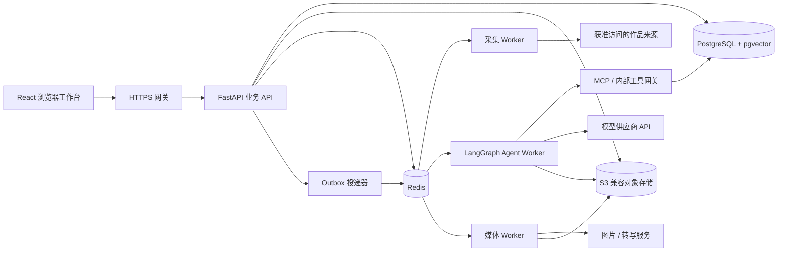

# 多 Agent 种草内容平台｜前后端技术方案

> 版本：V2.0，2026-11-18  
> 产品依据：[产品方案-多Agent热点内容创作平台.md](产品方案-多Agent热点内容创作平台.md)  
> 本文是 P0 实施基线。`P1` 标记的能力不计入首期验收。

## 1. 结论与范围

### 1.1 已确认的业务条件

- 团队通过浏览器使用云端系统；管理员创建账号，用户以邮箱或用户名及密码登录。
- 公司提供模型供应商 API Key，由平台管理员配置。首期支持可替换模型连接，不绑定单一厂商。
- 首期自建 Python 采集工具；商业数据源仅在自建来源覆盖不足时评估。自动发现的对象是**高表现种草图文和视频作品**，不是泛热搜词。
- 当前行业是 3C 全品类；品类树、字段、筛选规则和 Skill 可配置，以便将来切换服装、美妆等行业。
- 产品库首期少于 1 万个 SKU，以结构化字段、图片和少量说明文档为主；用户只能看到获授权产品。
- 图文首期完成文章、图片、保存和下载；视频首期完成剧本与分镜并下载，`P1` 才生成成片。
- 作品仅有链接或摘要而无可用正文、图片或视频时，用户先上传有权使用的素材或粘贴内容，再进入分析。
- AI 内容审核由创作者按需触发；未审核成果可保存和下载，但必须标记状态。首期不直发公众号、抖音或小红书。

### 1.2 核心技术决定

1. **LangGraph 多 Agent 图**：外层管理分支、交接和人工确认；文章、编剧、美工、分镜等 Agent 在各自节点内自主规划、调用工具、自检和迭代。
2. **FastAPI + PostgreSQL**：提供业务 API、产品事实、权限、工作流和不可变产物版本；LangGraph 检查点只保存运行态。
3. **Celery + Redis**：执行采集、Agent、媒体等长任务；数据库 outbox 保证业务提交后任务可靠投递。
4. **React + TypeScript**：提供热点大厅、聊天式工作流、编辑器、产品库与配置后台。
5. **产品混合推荐**：SQL 先执行权限/状态硬过滤；词项检索与 pgvector 语义检索双路召回；适配重排后按 65/60 阈值展示。PostgreSQL 是产品事实库，向量只是索引。
6. **Skill + MCP**：版本化 Skill 指导 Agent 方法；MCP/内部工具提供受控能力。每次工具调用仍在服务端鉴权、限额和审计。

## 2. 系统架构与部署

首期采用**模块化单体**：身份与授权、产品与行业、作品采集、热点大厅、工作流、Agent 运行、资产、审核、费用、审计分模块实现，共享一个业务数据库但不跨模块随意写表。Web/API/Worker/调度器独立进程，可按队列分别扩容。正式环境使用 HTTPS、托管 PostgreSQL、对象存储、数据库备份和集中日志；具体云厂商在采购时确定。

技术建议：React + TypeScript + Vite、TanStack Query、Tiptap（文章编辑）、FastAPI + Pydantic、SQLAlchemy + Alembic、PostgreSQL + pgvector、LangGraph、LangChain 模型/MCP 适配、Celery + Redis、S3 兼容存储。依赖版本在初始化时锁定并做兼容性验证。[LangGraph API](https://reference.langchain.com/python/langgraph/overview)提供状态图和检查点；[pgvector](https://github.com/pgvector/pgvector)支持在 PostgreSQL 内做精确向量检索。

## 3. 工作流与 Agent 运行架构

### 3.1 外层业务图与人工门槛

外层 LangGraph 图负责 `素材可用 → 类型分析 →（按需）产品选择 → 内容创作 → 用户确认 →（按需）图片/分镜 → 最终确认 → 保存/按需审核`。**纯文字热点**按 PRD 跳过产品和美工；带图图文按产品线索或用户主动关联决定是否选产品，有图片占位才进入美工；视频按产品线索或用户主动关联决定是否选产品，但始终进入剧本和分镜。模型可以建议补资料或重做，但不能跳过实际进入的人工确认门槛。视频 P0 到分镜确认即结束；没有成片生成节点。

LangGraph PostgreSQL checkpointer 存图运行态和人工中断；业务表保存当前节点、产物版本、用户选择及审计事件。到达人工确认时，Worker 结束任务；用户确认后 FastAPI 校验 `workflow_id + checkpoint_id + artifact_version_id`，再投递恢复任务，使用同一 `thread_id` 继续，避免长时间占用 Worker。上游产物被修改时，下游版本标记 `stale`，不能继续当成当前成品。

### 3.2 Agent 内部自主循环

每个创作 Agent 是可循环的子图：`理解目标 → 制定本轮计划 → 按需加载 Skill/调用工具 → 生成或局部修改 → 核对事实与质量 → 继续修正或提交候选`。文章 Agent 可以先找产品卖点依据，再设计三种写法并自检；编剧 Agent 可以拆解参考视频、规划时长、写场景并检查节奏；分镜师可逐镜检查剧本覆盖和总时长。业务外层仍掌握最终交接。

每次运行固定：输入快照、行业配置、产品权限、模型/提示词/Skill 版本、工具白名单、最大循环次数、最大工具调用数、Token/费用上限和超时。达到上限或缺资料时返回“未完成/需补充”及原因，不无限循环。**每个 Agent 的执行过程都应实时可见并可回看**：展示阶段、正在做的事、已查到的依据、工具调用结果、版本变化和待用户处理的问题；不展示模型内部原始推理文本。

### 3.3 Agent 职责与交付物

| Agent | 自主能力与工具 | 交付物 | 用户确认点 |
| --- | --- | --- | --- |
| 采集/筛选 Agent | 来源适配器、去重、行业与种草意图分类、热度校验 | 作品候选、来源、热度依据、过滤理由 | 低置信度作品复核 |
| 分析 Agent | OCR、转写、关键帧、热点摘要、产品线索识别 | 内容类型、摘要、线索、依据片段、置信度 | 类型不确定或素材不足时确认 |
| 产品推荐服务 | 授权 SQL 查询、词项/向量召回、适配评分 | 最多 10 条候选、维度分、理由、限制 | 用户选择、放宽阈值或无产品继续 |
| 文章 Agent | 查已选产品依据、选角度、三种风格写作、局部改写、自检 | 三篇结构化文章、段落 ID、图片占位 | 选稿、局部修改、定稿 |
| 美工 Agent | 按占位规划图、合成/生成、核对产品外观 | 每个占位的图片候选、来源和版本 | 逐图确认或替换 |
| 编剧 Agent | 分析参考视频、规划节奏、写场景、自检/局部改写 | 剧本场景、台词、时长、产品位置 | 剧本定稿 |
| 分镜师 Agent | 逐镜规划构图、景别、运镜和草图、自检 | 镜头卡、草图、所需素材与总时长 | 逐镜调整并定稿 |
| 审核 Agent | 规则检查、OCR、产品事实/授权核对 | 定位问题、级别、依据、建议 | 创作者按需触发；不自动改稿 |

产品推荐以服务实现为主：模型可提取场景和解释推荐，但不能自行编造分数、越权查询全库。是否拆出新的专业子 Agent，以独立能力、模型或权限边界为依据，不为增加 Agent 数量而拆分。

### 3.4 每个 Agent 的可见执行记录

用户要求每个 Agent 都能展示“思考过程”。产品上实现为**可验证的工作过程和决策摘要**：Agent 正在处理什么、选择了什么方法、引用了哪些素材/产品依据、调用了什么工具、得到什么结果、为何继续迭代、最后提交了哪个版本。模型内部逐 token 的原始推理不可作为稳定、可核验的产品数据；界面不将它伪装成真实日志。

所有 Agent 使用统一事件结构：`event_id, workflow_id, agent_run_id, agent_type, sequence, occurred_at, phase, event_type, title, summary, evidence_refs, tool_name, artifact_version_id, status, visibility`。`phase` 由运行图节点产生；`event_type` 至少包括 `started`、`plan_summary`、`evidence_found`、`tool_started`、`tool_finished`、`draft_created`、`self_check`、`revision`、`needs_input`、`completed`、`failed`。事件先持久化再推送，`sequence` 保证刷新后顺序一致。工具调用事件由工具网关生成，不由模型自己声称“已经调用”；证据链接指向已授权的热点、产品字段或文档片段。

每个 Agent 的可见内容最低要求：

- **采集/筛选**：来源与采集时间、候选数、去重/过滤数、行业/热度依据、失败原因。
- **分析**：素材读取状态、识别出的类型与产品线索、对应原文/转写片段、置信度及不确定项。
- **产品推荐**：权限过滤后的候选数量、词项/语义召回贡献、评分维度、推荐理由与限制；不得显示未授权产品信息。
- **文章/编剧**：创作目标与选定 Skill、结构大纲、已核实的产品依据、草稿版本、自检发现和修订摘要；局部修改显示变更差异。
- **美工/分镜**：每个占位或镜头的方案、引用素材、生成/调整状态、检查结果和当前版本。
- **审核**：使用的规则版本、检查范围、逐项问题、证据及结论。

工作流页为每个 Agent 提供可展开的“执行过程”面板，按时间线显示事件；正在运行时通过 SSE 推送，断线后以 `Last-Event-ID` 续接，SSE 不可用时轮询补齐。摘要用简短、可读的业务语言，默认显示关键事件，用户可展开工具详情。错误和“未找到依据”必须如实显示；不制造看似合理却没有真实工具记录的步骤。事件按用户权限过滤，密钥、完整外部请求、隐私字段及模型原始推理不得暴露。日志与产物版本关联，默认遵循 90 天保留策略。

## 4. Skill、MCP 与模型配置

**Skill** 使用版本化 `SKILL.md` 与机器可校验 manifest，包含名称、描述、适用行业/Agent、输入变量、依赖工具、示例和发布状态。示例：3C 测评写法、小红书种草结构、30 秒剧本节奏、品牌表达规则。Agent 先选匹配 Skill，再加载正文与必要资料；管理员可测试、发布、回滚。Skill 只提供方法，不能扩大权限。需执行脚本的 Skill 必须经审核并在隔离 Worker 中运行。

**MCP/内部工具网关**首期暴露 `search_authorized_products`、`get_product_evidence`、`get_hotspot_material`、`read_allowed_asset`、`create_image_candidate`、`check_claims`、`save_draft_candidate`。外部 MCP 由管理员登记地址、凭据、工具列表、超时和数据出站范围。Agent 配置工具白名单；每次调用再按租户、用户、工作流、产品 ID 和工具参数鉴权。只读检索可自动执行；计费工具受预算限制；删除、改产品资料、外部发布等写操作需要明确授权。调用记录工具版本、输入输出摘要、费用和结果。MCP 返回内容按非可信数据处理。

模型连接按能力配置：文本、视觉、图片、转写/语音；每个 Agent 指定主模型、可选备用模型、超时、并发和单次预算。公司 API Key 在服务端加密保存，不向前端回显。模型连接、提示词和 Skill 都按版本固定在一次运行中。供应商切换不改变业务权限、产品事实或工作流状态。[LangChain MCP 适配参考](https://reference.langchain.com/python/langchain-mcp-adapters)。

## 5. 产品库、RAG 与混合推荐

### 5.1 产品数据的事实边界

PostgreSQL 是唯一产品事实库：SKU、名称、行业/品类、品牌、型号、规格、适用场景、卖点、禁用宣称、素材、授权、状态与资料版本。行业扩展字段放 JSONB，并按版本化规则校验。管理员建产品组和授权，产品管理员录入、CSV 批量导入和发布；无权产品在搜索、推荐、详情、图片、模型上下文和日志中都不可见。产品被撤权或素材到期后，禁止新的生成与下载。

少量说明文档解析成带页码/章节的可引用片段，只在**用户已选产品**范围内供文章、编剧和审核 Agent 查证产品规格与宣称。这是产品资料 RAG；检不到证据就不写确定性卖点。向量索引不是产品事实来源，图片也不自动转成事实。

### 5.2 内容到产品的推荐管线

输入不是购物搜索词，而是一篇种草图文或视频。分析 Agent 先提取行业、品类、目标受众、使用场景、痛点、原文品牌/型号、创作角度和置信度。推荐服务执行：

1. **硬过滤**：在 SQL 中限定租户、用户授权、已发布且素材可用的产品；兼容性冲突、授权到期和明确品牌禁用是硬拒绝。
2. **双路召回**：词项路匹配型号、品类、标签、卖点和场景；语义路把内容整理为“需求/场景/受众/产品类型”查询向量，在硬过滤后的产品集合内用 pgvector 精确距离计算。两路去重合并，默认候选上限 100。少于 1 万 SKU 时先不用 HNSW 近似索引。
3. **适配重排**：判断产品与内容是直接同类、互补配件、可自然延伸，还是牵强植入。按 PRD 的场景 35、受众 20、卖点 20、素材 15、品牌/合规 10 计算 0–100 分；语义相似度只参与场景维度，不能直接作为推荐分。限制条件和缺失资料要显示。
4. **分层展示**：首轮 `≥65` 且最多 10 条；用户放宽后显示新增的 `≥60` 候选；仍无合适产品时开放授权产品搜索。也允许返回“无合适产品”，用户按无产品路径创作。
5. **锁定快照**：用户确认产品后保存产品资料/授权版本。下游 Agent 只能读该快照与其证据；改选产品使下游内容过期。

产品发布或语义字段变更时，异步更新 `product_embeddings`（产品 ID、产品版本、embedding 模型 ID、向量与时间）。未完成更新的产品仍参与词项路。更换 embedding 模型要重建索引，不能混用不同模型向量。首期用人工标注的“作品—适合产品”样本比较词项、语义、混合三路的 Recall@10、前 3 条接受率、无合适产品判断和 p95 延迟；65/60 阈值经样本校准。精确向量搜索及过滤方式参考 [pgvector 官方说明](https://github.com/pgvector/pgvector)。

## 6. Agent 间通信与产物版本

跨业务节点采用**结构化产物 + LangGraph 状态引用 + outbox 事件**，Agent 不直接互发整篇聊天消息。图状态只存 ID 和小型状态；正文、剧本、分镜存不可变 `artifact_versions`；图片和视频在对象存储。文章段落、图片占位和分镜镜头各有稳定 ID。

**文章 → 美工**：文章 Agent 生成三篇候选，每篇有标题、段落、图片占位描述、产品/热点快照引用和内容哈希。用户选稿并修改；点击确认后 FastAPI 校验版本、权限和占位完整性，在事务中把文章版本标为 `approved` 并写 `artwork_requested` outbox 事件。事件只传 `handoff_id`、`workflow_id`、`article_version_id`、`product_snapshot_id`、`slot_ids`、预期哈希与配置版本，不传大段正文和图片二进制。美工 Worker 按 ID 重新鉴权读取资料，逐占位出图并写 `ImageCandidate`；完成后发 `artwork_candidates_ready`，等待用户逐图确认。相同 `handoff_id` 重试只创建一个任务；文章/产品改动使旧图片候选 `stale`；单图失败只重试对应占位。

编剧 → 分镜传已确认剧本版本和镜头约束；分析 → 产品推荐传分析版本；最终产物 → 审核传最终版本 ID。局部修改请求带基版本、目标单元 ID 和选区哈希；服务端验证非目标内容不变，返回差异供用户接受。审核结论只绑定被审版本，修改后显示“审核后已修改”。

## 7. 前端方案

页面路由：登录、热点大厅/作品详情、聊天式工作流入口、工作流工作台、内容库、产品库、行业配置、采集来源、Agent/模型/Skill/MCP 配置、日志与用户管理。工作流台采用节点时间线、当前产物区和聊天/操作区；聊天指令可发起局部改写，关键决定仍由独立确认按钮提交。桌面浏览器为复杂编辑主验收环境，手机端首期支持浏览与简单确认。

React 前端通过 OpenAPI 生成的 TypeScript 客户端调用 FastAPI。TanStack Query 管理服务端数据；文章用 Tiptap 选中段落与差异预览，剧本/分镜用结构化卡片编辑。写操作带 `base_version_id`/ETag；409 冲突时保留本地草稿并提示比较。**首期以 SSE 实时展示每个 Agent 的执行事件**，断线后按事件序号补读，SSE 不可用时以 2–5 秒轮询兜底。页面刷新从服务端和检查点恢复，不依赖浏览器聊天记录。未审核、审核通过、审核后修改分别显示；保存和下载不隐式触发审核。

## 8. 数据模型与 API

主要表：`users/sessions/roles`；`industry_profiles/industry_versions`；`products/product_groups/product_grants/product_assets/product_documents/product_doc_chunks/product_embeddings`；`source_configs/crawl_runs/source_items/hotspots/hotspot_evidence`；`workflows/workflow_steps/workflow_events/agent_handoffs`；`artifact_versions/artifact_units/assets`；`agent_configs/agent_runs/agent_run_events/prompt_versions/skills/skill_versions/mcp_servers/mcp_tools/tool_call_logs`；`review_results/usage_ledger/audit_events/outbox_events`。`agent_run_events` 按 `agent_run_id + sequence` 唯一，保留可见执行时间线及证据引用。LangGraph checkpoint 表单独保存运行态。所有业务查询按 `tenant_id` 和对象授权过滤；重要产物版本不可覆盖。文件只在对象存储，数据库保存引用、哈希和授权。

API 统一 `/api/v1`，JSON + 游标分页；写接口支持 `Idempotency-Key`，版本编辑带 `If-Match` 或基版本 ID。关键能力：登录与账号管理；产品/分组/授权/导入；行业配置；采集来源测试与作品检索；创建/查询/取消/恢复工作流；推荐与产品选择；产物版本、局部修改与确认；按需审核、保存和导出；模型、提示词、Skill、MCP 测试/发布；任务与交接日志。增加 `GET /workflows/{id}/agent-runs`、`GET /agent-runs/{id}/events` 和 `GET /agent-runs/{id}/events/stream`，分别用于运行列表、历史过程和 SSE 实时过程。错误格式 `code, message, retryable, trace_id, details`；无权资源不泄露其存在。上传先取短期直传凭据，完成安全检查后才入正式资产。

## 9. 采集与素材边界

Python `SourceAdapter` 统一实现 `fetch(cursor, since)`、`normalize(raw)`、`allowed_fields` 和 `rate_policy`。来源仅接已获授权的官方接口、明确允许自动访问的公开线索或用户手动提交素材；商业接口以后按同协议接入。调度器按来源频率入队，记录游标、响应、错误与下次运行时间；限流退避，连续失败告警。按来源作品 ID、规范化 URL 和内容指纹去重。筛选顺序为行业/品类、种草意图、热度证据、可访问和授权状态；热度只在同平台、同内容类型与时间窗比较。

抖音官方热门视频榜需从零申请权限，且是全站榜单，不能保证每天有足量 3C 种草作品。小红书和公众号全站作品自动采集也不能在未确认允许的接入方式前承诺。大厅必须标明每个来源实际覆盖的内容类型；来源只提供标题/链接时，不自动臆测正文或视频，用户选中后须补充有权使用的素材。自建来源连续运行两周，记录合格作品数、品类覆盖、图文/视频比例、人工标注准确率、延迟和维护成本；不足再启动商业数据源备选评估。

## 10. 安全、费用与运行可靠性

账号密码使用 Argon2id 哈希；会话采用 HttpOnly Cookie、超时和限速；模型 API Key 加密存储且不回显。外部链接导入必须阻止内网/环回/云元数据访问，逐跳校验重定向并限制大小、类型和时间。上传文件做格式、大小和恶意内容检查；文件访问使用短期签名 URL。热点内容、MCP 返回和用户上传资料均是非可信输入，不得改变系统提示词或工具权限。

Celery 任务允许至少一次执行，因此用业务唯一键、`handoff_id`、产物哈希和幂等记录避免重复生成/扣费。模型调用先估算并预留预算，完成按实际费用回填，失败释放余额；租户每日额度按北京时间重置，未配置额度时不启动计费任务。采集、Agent、媒体队列独立限流。每次请求和 Agent/MCP 调用关联 `trace_id/workflow_id/task_id`，记录模型、提示词、Skill、工具版本及耗时；日志不保存明文密钥。默认数据保留 90 天，管理员可配置，并提供到期提醒与删除审计。

## 11. 分期实施与验收

1. **基础层**：云环境、CI、数据库迁移、账号/权限、产品库、对象存储。验收无权产品在接口、搜索和模型上下文中均不可见。
2. **Agent 底座**：LangGraph 图/检查点、Celery/outbox、模型适配、Skill 版本、MCP 工具网关、产物版本和人工中断。验收 Worker 重启可恢复、用户确认前不推进、重复事件不产生重复任务。
3. **图文闭环**：手动素材入口、分析、混合推荐、三稿与局部改写、美工逐图、按需审核、内容库和下载。验收非目标段落不变、撤权即时生效、旧审核不沿用、无产品可继续。
4. **视频 P0**：视频解析、编剧、分镜与导出。验收可逐场景/镜头调整，剧本与分镜版本可追溯；不出现成片生成按钮。
5. **自建采集**：至少一个确认可自动访问的真实来源接入、连续运行两周，人工抽样验证行业相关性与热度证据。未覆盖的渠道在界面标明，不用模拟数据冒充真实覆盖。
6. **P1/P2**：成片生成、镜头级返工、多来源扩展；随后对接公众号/抖音/小红书发布和效果回收，逐平台单独验证权限、格式和回执。

需要重点测试：类型分支、Agent 输入输出 Schema、循环/预算上限、MCP 越权、产品双路召回与适配重排、65/60 分层、无合适产品、Agent 交接幂等、并发编辑 409、上游返工下游失效、采集限流/空结果/授权失效、素材安全和导出版本。**每个 Agent 的执行事件**需验证真实来源、顺序、SSE 断线续接、权限过滤、证据可访问性以及错误如实显示；不得出现未发生的工具调用记录。产品推荐使用人工标注样本比较词项、向量和混合路线的 Recall@10、前 3 条接受率、无产品判断及 p95 延迟；不能只以向量相似度证明效果。

## 12. 待落实的外部条件与参考

开工可按上述结构推进；真实接入仍需落实：首个允许自动访问的作品来源及字段范围、抖音权限申请负责人、云厂商与域名、首批模型 Key 和图片/转写额度、每日预算金额、产品素材授权、品牌禁用词和首批标注样本。来源未确认不阻塞基础平台和手动入口开发，但阻塞“自动发现作品”真实验收。

可参考的公开方案：[Walmart 混合商品检索论文](https://arxiv.org/abs/2412.04637)说明词项与语义双路召回；[Amazon ESCI](https://www.amazon.science/code-and-datasets/shopping-queries-dataset-a-large-scale-esci-benchmark-for-improving-product-search)提供分级相关性标注思路；[catalog_rag_search](https://github.com/denissarapin/catalog_rag_search)展示 FastAPI + PostgreSQL + pgvector 小型实现；[langgraph-marketing-agent](https://github.com/IhsanKhann/langgraph-marketing-agent)展示内容、视觉和审批的多 Agent 管线。这些案例的输入和权限条件与本项目不同，只参考其机制，实际效果以本项目样本验收。
